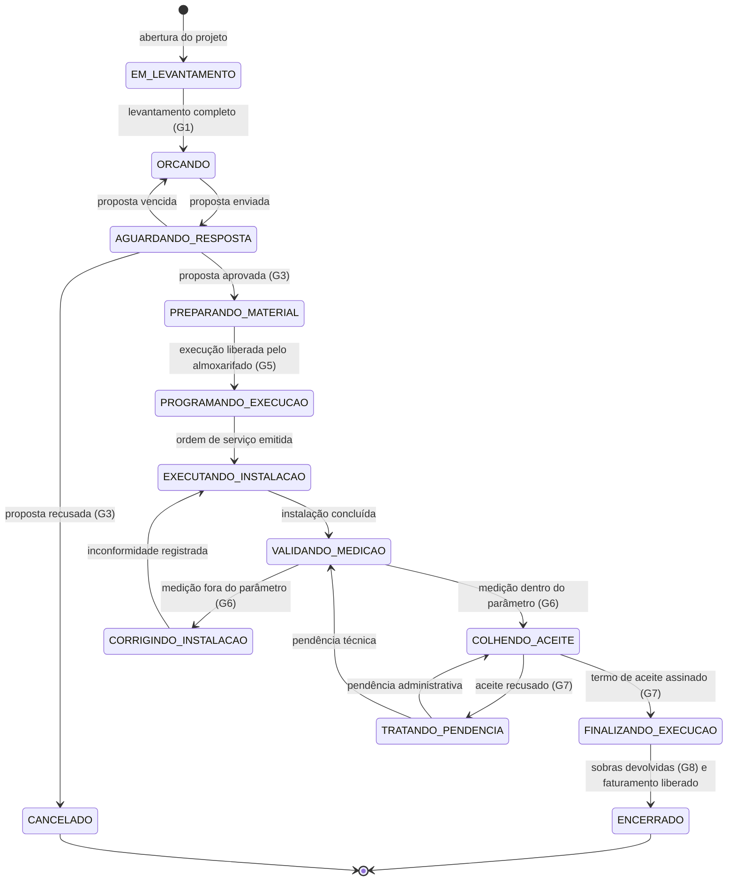

# Gestor de Irrigação

Sistema web de gestão de projetos de irrigação, feito como Trabalho de Conclusão de Disciplina (TCD) de Engenharia de Software III no IFTM.

O sistema acompanha o projeto de irrigação do começo ao fim: cadastro do produtor, visita técnica, levantamento em campo, dimensionamento, orçamento e proposta, compra e separação do material, instalação, medição, aceite do cliente, devolução das sobras, liberação do faturamento e garantia. Cada área da empresa (comercial, engenharia, estoque, campo, financeiro e diretoria) trabalha na sua parte, e o sistema controla em que situação o projeto está e quem é o próximo a agir.

## Sumário

- [Funcionalidades](#funcionalidades)
- [Ciclo de vida do projeto](#ciclo-de-vida-do-projeto)
- [Perfis de acesso](#perfis-de-acesso)
- [Stack](#stack)
- [Arquitetura](#arquitetura)
- [Estrutura de pastas](#estrutura-de-pastas)
- [Regras de negócio](#regras-de-negócio)
- [Como rodar](#como-rodar)
- [Login e usuários](#login-e-usuários)
- [Testes](#testes)
- [Quando zerar o banco de desenvolvimento](#quando-zerar-o-banco-de-desenvolvimento)
- [Parâmetros de negócio](#parâmetros-de-negócio)
- [Requisitos do TCD](#requisitos-do-tcd)
- [Histórico de desenvolvimento](#histórico-de-desenvolvimento)

## Funcionalidades

**Comum a todos os perfis**
- Painel inicial com o que cabe ao perfil logado.
- Lista de projetos com filtro por fase e situação, e o próximo passo de cada projeto.
- Página do projeto com uma aba por fase. A página abre na fase atual e mostra o que falta fazer e com quem está. Só quem pode fazer o passo vê o botão.
- Linha do tempo com cada mudança de situação, quem fez e quando.
- Agenda semanal das visitas, com calendário do mês.

**Comercial**
- Cadastro de produtores (CPF ou CNPJ validado e único) e das propriedades.
- Abertura do projeto e agendamento da visita técnica.
- Orçamento feito a partir da lista técnica e do cadastro de preços, com mão de obra calculada pela área irrigada.
- Proposta com desconto. Acima da alçada do vendedor, o desconto vai para a diretoria aprovar.
- Envio e impressão da proposta, alerta antes do vencimento e vencimento automático.
- Resposta do cliente: proposta aprovada, recusada ou vencida, com novo orçamento.

**Engenharia**
- Fila dos projetos que esperam dimensionamento, programação ou nova ordem de serviço.
- Registro do dimensionamento (pressão, vazão e tolerância) e montagem da lista técnica de materiais.
- Programação da equipe e emissão da ordem de serviço.

**Estoque e compras**
- Cadastro de materiais com preço de venda e custo, entradas, ajustes e extrato de movimentações.
- Reserva de material por projeto e indicação dos itens que faltam.
- Cotação com fornecedores, requisição de compra e recebimento.
- Fila do almoxarifado, separação do material (inclusive aos poucos, durante a obra) e conferência com a lista técnica.
- Recebimento das sobras no fim da obra.

**Campo**
- Levantamento na propriedade com fotos (câmera do celular) e coordenadas (GPS do navegador).
- Minhas ordens de serviço, com apontamento de horas e de materiais consumidos.
- Medição de pressão e vazão com foto, conferida pelo sistema contra o dimensionamento.
- Termo de aceite assinado na tela, ou registro de pendência.

**Financeiro e diretoria**
- Liberação do projeto para faturamento, que encerra o projeto e começa a garantia.
- Aprovação dos descontos acima da alçada.
- Orçado x realizado dos projetos encerrados, com margens e exportação em CSV.

**Administração**
- Cadastro de usuários, troca de senha, perfil, ativação e desativação.

## Ciclo de vida do projeto

O projeto passa por 13 situações. As transições permitidas estão em `TransicoesProjeto`, e toda mudança passa por `ProjetoService.transitar(...)`, que valida a transição e grava o `HistoricoProjeto` na mesma transação. `ENCERRADO` e `CANCELADO` são finais.



Os gateways G1 a G8 são os do BPMN TO-BE do TCD. Dois deles não mudam a situação: o G2 (desconto dentro da alçada), decidido em `ORCANDO`, e o G4 (há saldo em estoque?), decidido em `PREPARANDO_MATERIAL`.

## Perfis de acesso

Cada área tem um prefixo de URL, liberado só para os perfis da tabela (`SecurityConfig`). O menu também muda conforme o perfil.

| Perfil | O que faz | Áreas |
|---|---|---|
| `VENDEDOR` | cadastra produtor e propriedade, abre o projeto, agenda a visita, monta o orçamento e a proposta | `/comercial` |
| `PROJETISTA` | dimensionamento e lista técnica, programação da equipe e emissão da ordem de serviço; também atua no campo | `/engenharia`, `/campo` |
| `COMPRADOR` | cotação dos faltantes, requisição de compra, cadastro de materiais e estoque | `/estoque`, faltantes do `/comercial` |
| `ALMOXARIFE` | estoque, separação e conferência do material, recebimento das sobras | `/estoque` |
| `TECNICO_CAMPO` | levantamento, apontamentos, medição, aceite e pendência | `/campo` |
| `FINANCEIRO` | liberação do faturamento e consulta do orçado x realizado | `/financeiro`, `/diretoria/orcado-realizado` |
| `DIRETORIA` | aprovação de desconto, acompanhamento do comercial e do financeiro, orçado x realizado | `/diretoria`, `/comercial`, `/financeiro` |
| `ADMINISTRADOR` | gerencia os usuários e acessa todas as áreas | todas, mais `/admin` |

Lista de projetos, página do projeto e agenda (`/projetos/**`) ficam abertas para qualquer usuário logado. Algumas ações dentro de uma área são de um perfil só. Por exemplo, a cotação é do comprador, a separação e as sobras são do almoxarife, e a liberação do faturamento é do financeiro.

## Stack

| Camada | Tecnologia |
|---|---|
| Linguagem e build | Java 21, Maven |
| Framework | Spring Boot 3.5.5 (Web, Validation, DevTools) |
| Persistência | Spring Data JPA com Hibernate, PostgreSQL 16 |
| Segurança | Spring Security 6: login por formulário, senha em BCrypt, CSRF ligado, autorização por perfil |
| Telas | Thymeleaf com `thymeleaf-extras-springsecurity6`, HTML, CSS e JavaScript puro |
| Visual | Bootstrap 5.3, Bootstrap Icons e Font Awesome, por CDN |
| Testes | JUnit 5, Spring Boot Test, MockMvc, Mockito, Spring Security Test, H2 em memória |
| Cobertura | JaCoCo 0.8.12 |
| Ambiente local | Docker Compose para o PostgreSQL |

Por decisão do projeto, não há Lombok, Flyway, Liquibase, JdbcTemplate nem framework JavaScript (React, Angular, Vue ou jQuery). As tabelas são criadas pelo Hibernate.

## Arquitetura

Aplicação monolítica em camadas, com pacotes que seguem o diagrama de pacotes do TCD:

```
apresentacao.web  →  dominio (services)  →  persistencia (repositórios)  →  PostgreSQL
```

- **apresentacao.web**: os controllers só recebem a requisição, chamam o service e devolvem a tela. Também ficam aqui os formulários com Bean Validation, os validadores próprios (CPF/CNPJ, login único, fotos) e os modelos de tela (próximo passo, abas, calendário).
- **dominio**: entidades JPA e regras de negócio. Cada service tem a interface no pacote do domínio e a implementação no subpacote `impl` (por exemplo, `dominio.estoque.EstoqueService` e `dominio.estoque.impl.EstoqueServiceImpl`).
- **persistencia**: um `JpaRepository` por entidade, só com consultas, sem regra de negócio.
- **config**: segurança, beans de infraestrutura (como o `Clock`), auditoria do JPA, agendamento e carga inicial.

Algumas decisões técnicas:

- **Situação do projeto centralizada.** Nenhuma tela muda a situação direto. O service da etapa confere a condição de negócio e chama `ProjetoService.transitar(...)`.
- **Estoque atômico (RNF05).** Entrada, reserva, baixa e devolução usam `UPDATE` condicional com conferência das linhas afetadas, em `@Transactional`. A tabela `material` tem um `@Check` que impede saldo negativo, e a separação trava os itens do projeto durante a operação.
- **Auditoria (RNF03).** As entidades editáveis estendem `EntidadeAuditada`, que grava quem criou, quem alterou por último e quando. Os eventos (histórico, movimentações, apontamentos, medições, aceite) gravam usuário e data em cada registro.
- **Tempo controlado.** Data e hora vêm de um bean `java.time.Clock`, e assim os testes conseguem simular vencimento de proposta e de garantia.
- **Erros de negócio.** São lançados como `RegraNegocioException` (e filhas) e tratados em um `@ControllerAdvice` (`TratadorDeErros`), com a mensagem na tela.
- **Fotos em disco.** As fotos do levantamento e da medição vão para `irrigacao.upload.dir`, com nome UUID, e o banco guarda só o caminho. O arquivo só é aceito se for JPEG ou PNG de verdade (o sistema confere os primeiros bytes), com até 5 MB. Se a transação for desfeita, o arquivo é apagado. A assinatura do aceite é gravada como PNG em base64.
- **Idioma fixo.** As telas e as mensagens ficam em pt-BR, qualquer que seja o idioma do navegador.
- **Telas de campo para celular (RNF06).** Uma coluna, poucos campos e botões grandes.

## Estrutura de pastas

```
.
├── docker-compose.yml           PostgreSQL 16 para desenvolvimento
├── pom.xml
├── scripts/
│   └── reset-dev.sql            apaga o schema do banco de desenvolvimento
├── docs/                        documentação do TCD (fora do Git)
├── uploads/                     fotos enviadas pela aplicação (fora do Git)
└── src/
    ├── main/
    │   ├── java/br/edu/iftm/irrigacao/
    │   │   ├── IrrigacaoApplication.java
    │   │   ├── apresentacao/web/      controllers, formulários, validadores e modelos de tela
    │   │   ├── config/                SecurityConfig, AppConfig, AuditoriaConfig, AgendamentoConfig, CargaInicial
    │   │   ├── dominio/
    │   │   │   ├── acesso/            Usuario, Perfil e autenticação
    │   │   │   ├── comercial/         Produtor, Propriedade, Orcamento, Proposta e verificação de vencimento
    │   │   │   ├── projeto/           Projeto, Levantamento, HistoricoProjeto, situações e transições,
    │   │   │   │                      dimensionamento, garantia, orçado x realizado e painel
    │   │   │   ├── estoque/           Material, ItemProjeto, MovimentacaoEstoque, Cotacao, separação e sobras
    │   │   │   └── execucao/          OrdemServico, Apontamento, Medicao, Aceite e Pendencia
    │   │   └── persistencia/          repositórios Spring Data JPA
    │   └── resources/
    │       ├── application.properties          configuração e parâmetros de negócio
    │       ├── application-dev.properties      perfil dev (SQL no log, senha padrão do admin)
    │       ├── messages.properties             mensagens de validação
    │       ├── static/                         css/app.css e js/app.js
    │       └── templates/                      Thymeleaf: acesso, campo, comercial, diretoria, engenharia,
    │                                           estoque, financeiro, projetos e fragments
    └── test/
        ├── java/br/edu/iftm/irrigacao/        testes de unidade, integração e sistema
        └── resources/application-test.properties   H2 em memória
```

O banco tem 18 tabelas: 16 entidades (as duas subclasses de `Apontamento` ficam na mesma tabela), a tabela das fotos do levantamento e a tabela dos técnicos de cada ordem de serviço.

## Regras de negócio

- O levantamento só segue para a engenharia com todos os campos obrigatórios preenchidos. Se faltar algum, ele volta para o campo (G1).
- O sistema **não calcula** o dimensionamento hidráulico. Ele registra a pressão, a vazão e a tolerância informadas pelo projetista (2% por padrão) e confere a medição de campo contra esses valores.
- O orçamento sai da lista técnica e do cadastro de preços, e o preço fica congelado na proposta. A mão de obra usa o preço da hora, e as horas sugeridas vêm da área irrigada.
- Desconto acima da alçada do vendedor (5% por padrão) depende da diretoria (G2).
- A proposta tem validade (15 dias por padrão) e entra em alerta 3 dias antes de vencer. Uma tarefa agendada vence as propostas atrasadas todo dia às 6h, e o projeto volta para `ORCANDO` para ser orçado de novo.
- O item sem saldo vira faltante. O comprador registra a cotação e, depois da aprovação, a requisição de compra. O recebimento dá entrada no estoque e reserva o material para o projeto (G4). A cotação também é aceita em `PREPARANDO_MATERIAL`, para o item que passou a faltar depois do orçamento.
- O almoxarifado pode liberar a execução com parte do material separado (G5). A separação e a compra continuam enquanto a equipe instala, até o aceite.
- O saldo do estoque nunca fica negativo, nem com acessos simultâneos.
- Medição fora do parâmetro leva à correção da instalação (G6). No aceite recusado, a pendência administrativa volta para o aceite e a técnica volta para a medição (G7).
- O encerramento exige as sobras devolvidas ao estoque (G8) e a liberação do faturamento pelo financeiro, que dá início à garantia.
- O orçado x realizado compara o valor da proposta, o custo orçado e o custo realizado (materiais apontados pelo custo atual do cadastro e horas apontadas pelo valor gravado em cada apontamento).
- O CPF/CNPJ do produtor aparece na página do projeto para qualquer perfil logado. Isso é uma decisão do projeto.

## Como rodar

É preciso ter Java 21, Maven e um PostgreSQL com um banco chamado `irrigacao`. Quem não tem o PostgreSQL instalado pode subir um pelo Docker:

```
docker compose up -d
```

A conexão padrão é `jdbc:postgresql://localhost:5432/irrigacao`, usuário `postgres`, senha `123456`. O PostgreSQL do `docker-compose.yml` usa a senha `postgres`. Para ele, ou para outro endereço, usuário ou senha, defina as variáveis de ambiente `DB_URL`, `DB_USER` e `DB_PASSWORD` antes de subir. No PowerShell:

```
$env:DB_PASSWORD = "postgres"
mvn spring-boot:run "-Dspring-boot.run.profiles=dev"
```

A aplicação abre em http://localhost:8080. Na primeira subida o Hibernate cria as 18 tabelas, e a carga inicial cadastra 22 materiais de irrigação. Nas subidas seguintes a carga só insere o material cujo código ainda não existe.

## Login e usuários

Todas as páginas exigem login. Não existe auto-registro: quem cria os usuários é o administrador, em Usuários (`/admin/usuarios`).

Na subida, se ainda não houver nenhum usuário com perfil ADMINISTRADOR, a carga inicial cria o login `admin` com a senha da variável de ambiente `IRRIGACAO_ADMIN_SENHA` (no mínimo 8 caracteres) e avisa no log. Sem a variável, o usuário não é criado. Só o perfil `dev` tem senha padrão, `admin1234`:

```
mvn spring-boot:run "-Dspring-boot.run.profiles=dev"
```

Troque a senha do `admin` em Usuários depois do primeiro acesso. O perfil do usuário define o menu e as áreas que ele acessa. A troca de perfil e a desativação valem a partir do próximo login.

## Testes

```
mvn verify
```

Os testes usam o H2 em memória no modo PostgreSQL (perfil `test`) e não dependem do PostgreSQL nem do Docker. A carga inicial e o agendamento ficam desligados, e o relógio é controlado pelos próprios testes.

| Nível | O que cobre | Exemplos |
|---|---|---|
| Unidade | regras isoladas | `TransicoesProjetoTest`, `CpfCnpjTest`, `ProximoPassoTest`, `MiniCalendarioTest` |
| Repositório | consultas, auditoria e a restrição de saldo no banco | `MaterialRepositoryTest`, `AuditoriaTest` |
| Integração | services, telas pelo MockMvc, permissões por perfil e concorrência no estoque | `PropostaIntegrationTest`, `SeparacaoIntegrationTest`, `SegurancaIntegrationTest`, `EstoqueConcorrenciaTest` |
| Sistema | o ciclo inteiro pelas telas, do cadastro ao encerramento, e os caminhos negativos dos gateways G1 a G8 | `FluxoCompletoSistemaTest`, `GatewaysNegativosSistemaTest` |

Para rodar uma classe só:

```
mvn test -Dtest=FluxoCompletoSistemaTest
```

O `mvn verify` também gera o relatório de cobertura do JaCoCo em `target/site/jacoco/index.html`.

Se o projeto estiver em uma pasta sincronizada pelo OneDrive, o `mvn verify` pode falhar de vez em quando com um template "might not be accessible", porque o OneDrive trava arquivos em `target/`. Rode de novo antes de procurar o erro.

## Quando zerar o banco de desenvolvimento

As tabelas são criadas pelo Hibernate com `ddl-auto=update`. Esse modo só acrescenta: cria tabela nova e coluna nova, mas não altera nem apaga o que já existe. Por isso, rode o `scripts/reset-dev.sql` sempre que mudar, numa entidade:

- o tipo de uma coluna (por exemplo, de `Double` para `BigDecimal`, ou o tamanho de um `String`);
- o nome de uma coluna ou de uma tabela (a antiga fica no banco e, se for `NOT NULL`, as inclusões passam a falhar);
- uma restrição: `nullable`, unicidade, o `@Check` de saldo do material ou os valores de um enum. O Hibernate grava no PostgreSQL uma restrição com a lista de valores de cada enum, e por isso o banco recusa um valor novo até a tabela ser recriada.

Coluna nova que aceita nulo e tabela nova não precisam de reset.

Com a aplicação parada:

```
psql -h localhost -U postgres -d irrigacao -f scripts/reset-dev.sql
```

O script apaga todas as tabelas e todos os dados (`DROP SCHEMA public CASCADE`). Na subida seguinte, as tabelas e os materiais da carga inicial voltam, e o resto do que estava cadastrado se perde. Use o script só no banco de desenvolvimento.

## Parâmetros de negócio

Ficam em `src/main/resources/application.properties`:

| Propriedade | Para que serve | Padrão |
|---|---|---|
| `irrigacao.proposta.validade-dias` | validade da proposta, em dias | `15` |
| `irrigacao.proposta.dias-alerta` | quantos dias antes do vencimento a proposta entra em alerta | `3` |
| `irrigacao.proposta.verificacao-cron` | quando as propostas enviadas que passaram da validade são vencidas (`-` desliga) | `0 0 6 * * *` (todo dia às 6h) |
| `irrigacao.alcada-desconto.vendedor` | desconto máximo, em %, que o vendedor dá sem a diretoria | `5` |
| `irrigacao.mao-obra.preco-hora` | preço de venda da hora de mão de obra, em R$ | `85.00` |
| `irrigacao.mao-obra.custo-hora` | custo da hora de mão de obra, em R$ | `45.00` |
| `irrigacao.mao-obra.horas-por-hectare` | horas de mão de obra por hectare irrigado, que sugerem as horas do orçamento | `60` |
| `irrigacao.upload.dir` | pasta das fotos enviadas (fica fora do Git) | `./uploads` |
| `irrigacao.admin.senha` | senha do `admin` criado na primeira subida; vem de `IRRIGACAO_ADMIN_SENHA` | vazio (`admin1234` no perfil `dev`) |

## Requisitos do TCD

Os 23 requisitos funcionais do TCD estão implementados:

| RF | Requisito |
|---|---|
| RF01 | Cadastro do produtor e da propriedade e abertura do projeto |
| RF02 | Agendamento da visita técnica |
| RF03 | Levantamento em campo com foto e coordenada |
| RF04 | Validação dos campos obrigatórios e devolução do levantamento |
| RF05 | Dimensionamento informado pelo projetista e lista técnica |
| RF06 | Cadastro de materiais e preços |
| RF07 | Controle de estoque: saldo, entradas, saídas e reservas por projeto |
| RF08 | Sinalização dos faltantes e cotação com fornecedores |
| RF09 | Orçamento a partir da lista técnica e do cadastro de preços |
| RF10 | Bloqueio do desconto acima da alçada e aprovação da diretoria |
| RF11 | Envio da proposta digital, controle de validade e alerta de vencimento |
| RF12 | Resposta do cliente: aceita, recusada ou vencida, com recálculo |
| RF13 | Requisição de compra dos faltantes |
| RF14 | Separação do material e conferência com a lista técnica |
| RF15 | Programação da equipe e emissão da ordem de serviço |
| RF16 | Apontamento de horas e materiais consumidos |
| RF17 | Medição de pressão e vazão validada contra o parâmetro do projeto |
| RF18 | Aceite do cliente ou pendência com reprogramação da visita |
| RF19 | Devolução de sobras ao estoque |
| RF20 | Liberação do projeto para faturamento a partir do aceite |
| RF21 | Início da garantia e histórico do projeto |
| RF22 | Comparação do custo orçado com o custo realizado |
| RF23 | Gerenciamento de usuários e perfis de acesso |

Situação dos requisitos não funcionais:

| RNF | Requisito | Situação |
|---|---|---|
| RNF01 | Aplicativo de campo sem conexão, com sincronização depois | Não atendido: só existe a aplicação web, que precisa de conexão |
| RNF02 | Câmera e GPS do dispositivo no levantamento | Parcial: a câmera funciona, mas o navegador só libera o GPS em HTTPS. Sem HTTPS, o técnico digita a coordenada |
| RNF03 | Usuário, data e hora de toda alteração | Parcial: os cadastros guardam só a criação e a última alteração |
| RNF04 | Autenticação e respeito ao perfil do usuário | Atendido |
| RNF05 | Movimentações de estoque atômicas, sem saldo negativo | Atendido |
| RNF06 | Telas com poucos campos para uso rápido em campo | Atendido, na web responsiva |
| RNF07 | Interface web nos navegadores comuns, sem instalação | Atendido |
| RNF08 | Consultas de saldo e de orçamento em até 3 segundos | Não comprovado: o tempo não foi medido com volume real |
| RNF09 | Backup diário da base de dados | Não atendido: depende do ambiente (por exemplo, um `pg_dump` agendado) |
| RNF10 | Dados pessoais dos produtores conforme a LGPD | Parcial: faltam consentimento, retenção e anonimização |

A rastreabilidade completa (requisito, atividade do BPMN, classe, tela e testes), o catálogo de casos de teste, o modelo de dados e os diagramas UML ficam na pasta `docs/`, que não vai para o Git.

## Histórico de desenvolvimento

O sistema foi construído em etapas, cada uma com o seu commit:

1. Esqueleto do projeto
2. Entidades JPA, auditoria, carga inicial e repositórios
3. Autenticação, autorização por perfil e gestão de usuários
4. Produtor, propriedade, abertura do projeto, agendamento da visita e situação do projeto
5. Cadastro de materiais e preços e controle de estoque
6. Levantamento em campo, dimensionamento e lista técnica
7. Faltantes e cotação, orçamento, alçada, envio, validade e resposta do cliente
8. Requisição de compra, recebimento, separação e conferência
9. Ordem de serviço, apontamentos, medição, aceite, pendência e sobras
10. Liberação do faturamento, garantia, histórico, orçado x realizado e painel inicial
11. Testes de ponta a ponta, cobertura e correções
